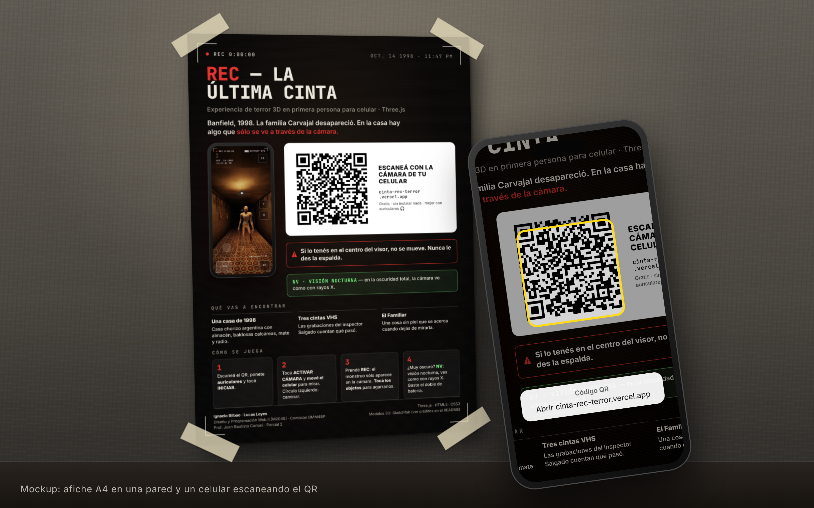

# REC — La Última Cinta

**Experiencia web 3D interactiva para celular hecha con Three.js.**
Terror *found footage* en primera persona: Banfield, octubre de 1998. La familia Carvajal desapareció y en la casa
hay algo que **sólo se ve a través de la cámara**.

- 🎮 **Jugar:** https://cinta-rec-terror.vercel.app/ (pensado para celular, con auriculares)
- 📱 **QR de acceso:** [`entrega/qr-cinta-rec-terror.png`](entrega/qr-cinta-rec-terror.png) · [SVG](entrega/qr-cinta-rec-terror.svg)
- 🖼️ **Afiche A4 con el QR:** [`entrega/afiche-A4.png`](entrega/afiche-A4.png) (300 dpi) · [PDF](entrega/afiche-A4.pdf)
- 🧱 **Mockup en contexto:** [`entrega/mockup.png`](entrega/mockup.png)

| | |
|---|---|
| **Integrantes** | Ignacio Bilbao · Lucas Leyes |
| **Materia** | Diseño y Programación Web II [M2045] — Comisión DMM4BP |
| **Docente** | Juan Bautista Carloni |
| **Trabajo** | Parcial 2: Experiencia Web 3D Interactiva para Mobile |



---

## 1. Concepto y propuesta visual

**Concepto.** El celular *es* la videocámara. Con el giroscopio mirás la casa moviendo el teléfono, como si
estuvieras filmando. A simple vista la casa parece vacía, pero al prender **REC** aparece el Familiar: una criatura
sin piel que **no se mueve mientras la tengas en el centro del visor** y se acerca cuando dejás de mirarla.
El objetivo es encontrar las 3 cintas VHS del inspector Salgado y salir por la puerta de la pieza del fondo.

**Propuesta visual.**
- **Estética VHS de 1998**: un único pase de post-proceso con ruido de sensor, scanlines, aberración cromática,
  glitches, contador REC, fecha y batería en pantalla.
- **Visión nocturna ("rayos X")**: la cámara ve en la oscuridad total con imagen verde e iluminador infrarrojo.
- **Ambientación argentina**: casa chorizo con baldosas calcáreas, almacén de barrio (estanterías, mostrador,
  balanza, libreta de fiado), mate y termo, radio de madrugada, ruda en la entrada y cintitas rojas.
  La historia toma la leyenda del **Familiar** de los ingenios de Tucumán.
- **Paleta**: ámbar de lámparas viejas contra negros profundos; verde fósforo para la visión nocturna; rojo REC.

## 2. Cómo se juega

1. Escaneá el QR, ponete **auriculares** y tocá **INICIAR** (se habilita cuando terminan de cargar los modelos 3D).
2. Leé **"Cómo se juega"** y tocá **ACTIVAR CÁMARA** (pide permiso para el giroscopio en iPhone).
3. Prendé **REC** para ver lo que el ojo no ve. Si está muy oscuro, **NV** (el botón titila para avisarte).
4. **La regla:** si lo tenés en el centro del visor, no se mueve. Nunca le des la espalda.

La pantalla "Cómo se juega" también está en la pausa (II).

## 3. Controles e interacciones

| Acción | Celular | Compu |
|---|---|---|
| Mirar | **mover el celular** (giroscopio); sin giroscopio, arrastrar el dedo | mouse (clic para capturarlo) |
| Caminar | **joystick táctil** (abajo a la izquierda) | W A S D / flechas |
| Agarrar / abrir / leer | **tocar el objeto en la pantalla** (Raycaster) o apuntar con el centro y tocar | E / espacio / clic |
| Cámara · Visión nocturna | **REC** · **NV** | C · N |
| Zoom | **T / W** o **pellizcar con dos dedos** | rueda o Z / X |
| Cambiar batería | **BAT +** | B |
| Cortar una cinta · Pausa | **■ STOP** · **II** | Q · Esc |

Interacciones de la escena: prender la radio del almacén, abrir y cerrar puertas, leer documentos (informe, carta,
almanaque, libreta de fiado), mirar la foto de familia (con la cámara cambia), agarrar cintas y baterías y ver las
cintas VHS (se reproducen *dentro* de la casa, renderizada desde donde fueron grabadas).

## 4. Requisitos técnicos de la consigna

### A. Escena 3D y Three.js
| Requisito | Implementación | Dónde |
|---|---|---|
| Geometrías complejas compuestas | Casa, muebles y objetos armados con primitivas combinadas (mesas, estanterías, radio, balanza, registradora, sifones, puertas con pivote, figura humanoide con esqueleto) | `src/scene/props.ts`, `src/scene/builders.ts`, `src/entities/Humanoid.ts` |
| Iluminación | `AmbientLight` + `HemisphereLight` de relleno, **pool de 4 `PointLight`** reasignadas a las lámparas cercanas, `SpotLight` del iluminador IR | `src/scene/HouseBuilder.ts`, `src/scene/lighting.ts`, `src/engine/Camcorder.ts` |
| Sombras optimizadas | **Una sola** `SpotLight` con sombra (mapa de 512 px, `PCFShadowMap`) que se ubica en la lámpara de techo más cercana. Sólo proyectan muebles, modelos y el monstruo; paredes y pisos sólo reciben. Si los FPS caen, se desactiva | `HouseBuilder.makeShadowLight / updateShadowLight`, `Engine.measure` |
| Materiales y texturas | Texturas generadas en canvas con mapeo en coordenadas de mundo (empapelados, calcáreas, madera, persiana); **materiales PBR** (`MeshStandardMaterial`) en los modelos GLB y el monstruo | `src/assets/textures.ts`, `src/scene/ModelKit.ts`, `src/entities/Monster.ts` |
| Modelos 3D | GLB animado del monstruo + desayuno argentino + mercadería del almacén, optimizados (texturas WebP) | `public/models/` |

### A2. Interactividad
- **Mecanismos táctiles**: giroscopio (`DeviceOrientation` con cuaternión), **joystick táctil** (Pointer Events
  con captura), **selección con `Raycaster`** desde el punto tocado (volúmenes invisibles por objeto, con
  oclusión por paredes y anillo de feedback), **botones UI superpuestos**, **pinch zoom**, arrastre para mirar.
  → `src/controllers/LookController.ts`, `src/components/Joystick.tsx`, `Engine.pickAt()`
- **Animaciones**: `AnimationMixer` con los clips del monstruo (idle / walk / attack; se congela cuando lo
  observás) y animaciones procedurales en `requestAnimationFrame` (puertas, péndulo, parpadeo de luces,
  balanceo de cámara en mano). → `src/entities/Monster.ts`, `Engine.frame()`

### A3. Cámara y control
- `PerspectiveCamera` con **FOV adaptado a la orientación** (más abierto en vertical para no perder campo).
- Control por **sensores** (giroscopio con recentrado) o **toque** (arrastre), con *pointer lock* en compu.
  → `LookController.setAspect()`, `src/controllers/GyroscopeController.ts`

### B. Optimización Mobile-First
- **Polígonos y texturas**: geometría estática **fusionada por material** (pocas draw calls), modelos de pocos
  vértices (monstruo ≈ 2.900), texturas WebP de 1024 px máx., luces en pool fijo (no recompila shaders).
- **Resize y PixelRatio**: `renderer.setPixelRatio(Math.min(window.devicePixelRatio, 2))` en cada resize y cambio de
  orientación; post-proceso a resolución interna adaptativa (baja si los FPS caen de 45).
- **Medidor de FPS**: pausa → *MEDIDOR DE FPS*, o abrir con `?fps` en la URL.
- **UI/UX**: HUD de videocámara en HTML/CSS superpuesto, botones grandes (≥ 48 px) en las esquinas
  para los pulgares, áreas seguras (*notch*), textos que se pueden scrollear en pantallas bajas.
- **Loader**: pantalla de arranque mientras baja el JavaScript y **barra de carga con porcentaje** de los
  modelos 3D (`THREE.LoadingManager` + progreso en bytes); *INICIAR* se habilita al terminar.
  → `src/engine/loading.ts`, `src/components/IntroScreen.tsx`

### C. Punto de acceso (QR)
- QR con corrección de errores alta (H) apuntando a **https://cinta-rec-terror.vercel.app/**, en PNG 2048 px y SVG.
- Integrado en un **afiche A4** que explica qué vas a encontrar, cómo se juega y la regla principal, más un
  **mockup** del afiche en una pared con un celular escaneándolo. Fuentes editables en `entrega/fuentes/`.

## 5. Estructura del código

```
src/
  engine/        Engine (loop, acciones, Raycaster), store de UI, carga de assets, cámara, cintas, radio
  scene/         Casa (HouseBuilder), luces y sombras, props procedurales, ModelKit (GLB), entidad
  entities/      Monstruo (GLB + AnimationMixer), humanoide procedural, puertas
  controllers/   Mirada (giroscopio / táctil / mouse), jugador con colisiones, giroscopio
  effects/       Post-proceso VHS y estática de TV (shaders)
  audio/         Audio 100% sintetizado con WebAudio y espacializado (HRTF), voz es-AR
  story/         Director: eventos narrativos y ambientales
  components/    Interfaz React superpuesta (intro, HUD, ayuda, pausa, pantallas)
  data/          Textos de cintas y documentos
entrega/         QR, afiche, mockup y sus fuentes
```

El juego corre en `Engine` fuera del ciclo de React; React sólo dibuja la interfaz superpuesta y lee un store
liviano. El código está comentado en español.

## 6. Ejecutar, publicar y regenerar el afiche

```bash
npm install
npm run dev          # http://localhost:3000
npm run build        # verifica tipos y genera dist/
npm run dev:https    # para probar el giroscopio desde el celular en la misma red (HTTPS)
```

- **Vercel**: el repo incluye `vercel.json`; cada push a `main` se publica en https://cinta-rec-terror.vercel.app/.
- **Afiche y mockup**: editar `entrega/fuentes/afiche.html` / `mockup.html` y correr
  `node entrega/fuentes/exportar.mjs` (requiere Playwright).

**Tecnologías:** Three.js r186, TypeScript (compila a JavaScript ES2022), HTML5, CSS3, React 19 (sólo la UI), Vite.

## 7. Créditos

**Modelos 3D (Sketchfab)**
- «Terror Engine - Skinless Crawler» de JuanCarlosOsanteHernandez — **CC BY-NC 4.0 (uso no comercial)** —
  https://sketchfab.com/3d-models/terror-engine-skinless-crawler-22e900c82b194a03bcba20c7765dadee
- «Breakfast (Argentina edition)» de Drawnah — CC BY 4.0 —
  https://sketchfab.com/3d-models/breakfast-argentina-edition-68489719319b4aa2b8d62b10c755d0db
- «Food Collection - Game Ready» de Melon Polygons — CC BY 4.0 —
  https://sketchfab.com/3d-models/food-collection-game-ready-969b4e6ef7444650ba8a22a46d57ff43

Los modelos se optimizaron para celular (texturas WebP, sin mapas de normales). Detalle en `public/models/CREDITS.md`.

**Otros**
- Foto de familia: imagen generada con IA, aportada por el equipo (`public/img/familia.webp`).
- Texturas, sonidos y voces: generados por código (canvas, WebAudio y `speechSynthesis`); no se usan archivos externos.
- Tipografías del afiche: Inter y JetBrains Mono (SIL Open Font License).
